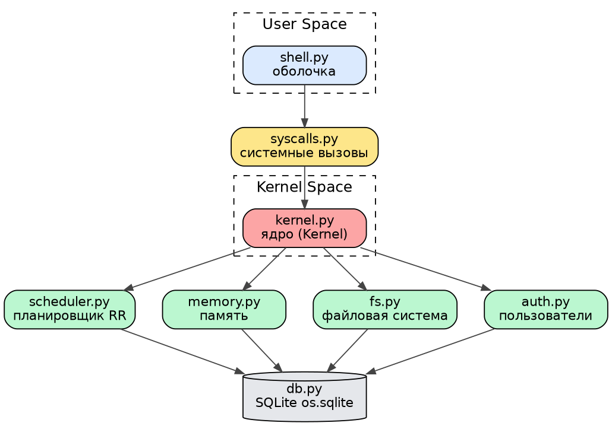

# my_os: архитектура и API ядра

## 1. Модули операционной системы

Архитектура — монолитное ядро, вызовы идут строго сверху вниз:
пользовательский уровень → интерфейс вызовов → ядро → подсистемы → хранилище.

| Уровень | Модуль | Назначение |
|---------|--------|------------|
| User Space | `shell.py` | интерактивная оболочка: разбирает команду и вызывает системный вызов |
| Граница | `syscalls.py` | единственная «дверь» в ядро: журналирует вызов, перехватывает ошибки |
| Kernel Space | `kernel.py` | класс `Kernel`: текущий сеанс, проверка прав, координация подсистем |
| Подсистема | `scheduler.py` | очереди готовых процессов по приоритетам, квант, такты, старение |
| Подсистема | `memory.py` | учёт выделенной процессам памяти и общий лимит |
| Подсистема | `fs.py` | файлы в таблице `files`: создание, чтение, удаление, список |
| Подсистема | `auth.py` | хэширование паролей, проверка логина, правила доступа |
| Хранилище | `db.py` | единственное соединение с SQLite и схема таблиц |

`config.py` — вспомогательный модуль констант, его могут импортировать все.

## 2. Системные вызовы

| Вызов | Сигнатура | Возвращает |
|-------|-----------|------------|
| вход | `sys_login(login: str, password: str) -> bool` | успех входа |
| выход | `sys_logout() -> bool` | True, если был сеанс |
| кто я | `sys_whoami() -> str` | логин или `guest` |
| создать файл | `sys_create_file(path: str, content: str) -> int` | fid или −1 |
| прочитать | `sys_read_file(path: str) -> str` | содержимое или `""` |
| удалить | `sys_delete_file(path: str) -> bool` | успех |
| список | `sys_list_files(path: str) -> list` | пути, начинающиеся с `path` |
| запуск | `sys_exec(name: str, priority: int = 1, memory_kb: int = 64) -> int` | PID или −1 |
| процессы | `sys_ps() -> list` | список словарей процессов |
| завершить | `sys_kill(pid: int) -> bool` | успех |
| память | `sys_mem_alloc(size: int, pid: int \| None = None) -> int` | всего выделено процессу или −1 |
| журнал | `sys_logs(limit: int = 10) -> list` | последние записи журнала |
| выключение | `sys_shutdown() -> bool` | True, все процессы завершены |
| такт (тема) | `sys_tick(count: int = 1) -> list` | PID, получавшие процессор |
| эхо (день 1) | `sys_echo(message: str) -> str` | то же сообщение |
| пользователи (день 1) | `sys_get_users() -> list` | логины и роли |

## 3. Контракты

**sys_exec**
- Предусловие: пользователь авторизован; `0 <= priority <= 3`; `memory_kb > 0`.
- Постусловие: создана строка в `processes` в состоянии `ready`, PID в очереди
  планировщика; при нехватке памяти или превышении 10 процессов возвращено −1.
- Побочный эффект: запись в `syscalls_log` (`ok` или `denied`).

**sys_kill**
- Предусловие: процесс существует, вызывающий — владелец или `admin`.
- Постусловие: состояние `terminated`, память процесса освобождена, PID удалён из очереди.
- Побочный эффект: запись в `syscalls_log`.

**sys_login**
- Предусловие: пользователь с таким логином есть в таблице `users`.
- Постусловие: при совпадении хэша установлен текущий пользователь, возвращено True; иначе False.
- Побочный эффект: запись в `syscalls_log`, пароль в журнале заменён на `***`.

## 4. Структуры данных

```python
process = {"pid": 7, "name": "compiler", "state": "ready",   # new|ready|running|waiting|terminated
           "owner": "student", "priority": 2, "memory_kb": 512,
           "cpu_ticks": 0, "created_at": "2026-09-14 10:05:11"}

file = {"fid": 3, "path": "/home/student/notes.txt", "content": "квант = 2 такта",
        "owner": "student", "created_at": "2026-09-14 10:06:40"}

user = {"uid": 2, "login": "student", "pwd_hash": "<64 hex-символа SHA-256>",
        "role": "user", "created_at": "2026-09-07 12:40:02"}

log = {"id": 41, "call_name": "sys_exec", "args": '{"name": "compiler", "priority": 2}',
       "user": "student", "status": "ok", "ts": "2026-09-14 10:05:11"}
```

## 5. Диаграмма компонентов



## 6. Реализация (день 2)

- `syscalls.py`: `log_syscall()` + 16 вызовов; журналирование и перехват ошибок
  вынесены в декоратор `@syscall`, поэтому каждая функция автоматически
  вызывает `log_syscall()`.
- `shell.py`: новые команды `whoami`, `login`, `logout`, `create`, `cat`, `rm`,
  `ls`, `run`, `ps`, `tick`, `kill`, `mem`, `logs`, `shutdown`; приглашение
  меняется с `guest@my_os` на `<логин>@my_os` после входа.
- Проверка: `python -m src.syscalls` добавляет в журнал 4 записи
  (`sys_login`, `sys_whoami`, `sys_create_file`, `sys_ps`).
